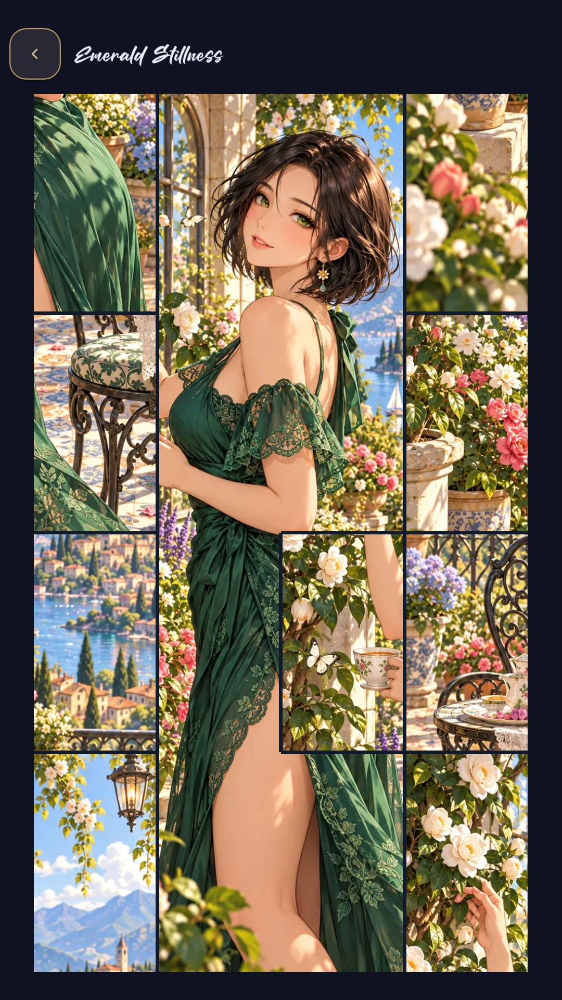

# Fragments of Dawn

A relaxing anime tile-swapping puzzle game made with **Godot and GDScript**, with **80 artworks**, **7 collections**, and a **dating sim in development**.

**[Download the Android game on itch.io](https://flavw.itch.io/fragments-of-dawn)**

Join Dawn on a journey to recover magical fragments scattered across different worlds. Peaceful gardens, sunlit shores, enchanted castles, and moonlit evenings bring new discoveries and new friendships.

<table><tr></td></tr></table>

## Play

Tap two tiles to swap their positions and complete a **4×4 picture puzzle**. There are no timers. Correctly placed neighboring tiles join visually, while each tile remains individually movable. Completed pictures become available in the gallery, with zoom, panning, and a tap-to-hide interface.

Progress and unfinished puzzles are saved locally. Landscape puzzles allow phone rotation; other puzzles and menus stay in portrait orientation. Android's Back button navigates back and asks before exiting from the home screen.

The game supports **English, Portuguese, and Spanish**. It initially follows the device language and remembers manual changes made in Options.

## Collections

| Collection | Artworks |
|---|---:|
| Quiet Moments | 12 |
| Golden Tides | 12 |
| High Fantasy | 12 |
| Sweet Encounters | 10 |
| Sporting Moments | 12 |
| Halloween Reverie | 12 |
| Velvet Evenings | 10 |
| **Total** | **80** |

Future updates are planned to include more collections, **male characters and couples**.

## Keys, medals, and achievements

The first six Quiet Moments puzzles are unlocked. Other puzzles cost one key. Unlocking a puzzle leaves it available permanently; select it again to start playing.

- Receive **one welcome key** on your first launch.
- Earn **one key every four puzzle wins**, including replays.
- Earn **two keys for completing each collection**, once per collection.
- Selected achievements grant **one key**; a small key icon identifies them.
- Character encounters can grant **one key per encounter**, once in total.
- The current wallet balance is capped at **99 keys**.

There are **74 achievements**, displayed alphabetically in the selected language. They cover artwork completion, gallery exploration, medals, replays, character connections, and other milestones. Collection medals unlock at **50% bronze, 70% silver, and 100% gold**.

There are no ads or in-app purchases. Download the ready-to-play Android build from itch.io rather than this source repository.

## New Friendships — in development

Open the crystal heart in the gallery to explore short character encounters. Each story has three opening choices and three follow-up choices per branch. The character's artwork must be completed before its encounter becomes available.

Currently, **24 encounters** are available across Quiet Moments and Golden Tides. Golden Tides encounters become available after finishing a conversation with all 12 Quiet Moments characters. Reunions remember the earlier encounter in their writing.

Positive answers can award the encounter's single key. You can replay a conversation to discover its best dialogue without receiving a second key. The best response unlocks a character achievement and the heart completion icon; dialogue quality is tracked separately from key rewards. More encounters are planned.

## Run the source project

1. Install **Godot 4.7.2**, the version used to verify this project, or a compatible Godot 4 release.
2. Clone or download this repository.
3. Import `project.godot` into Godot and let the assets finish importing.
4. Press **F5** to run the game.

The project uses the **Compatibility** renderer and requires no third-party Godot plugins. Android builds additionally require the matching Godot export templates, an Android SDK, and a JDK. `export_presets.cfg` contains the Android preset; use your own signing key for your builds.

### Fonts in the public source

This public copy uses **Carlito** for interface text and **Kaushan Script** for decorative headings, both under the SIL Open Font License. Their license texts are included in `fonts/`. Screenshots show the distributed game's original typography. Proprietary font files used in the original development project are not distributed here.

## Project layout

- `scripts/` — puzzle logic, progress, achievements, audio, navigation, and gallery.
- `content/images/` — the 80 artwork assets, ordered by collection and filename.
- `content/artwork_titles.json` — localized artwork titles.
- `content/spanish.json` and `scripts/locale.gd` — interface localization.
- `content/friendships.json` — branching conversations, portraits, and response quality.
- `content/about.json` — the localized About page.
- `art/` — interface assets, icons, and achievement artwork.
- `audio/` — ambient music and sound effects.
- `fonts/` — redistributable fonts and their licenses.
- `docs/screenshots/` — screenshots used in this README.

See [Adding artwork](content/images/README.md) for filename, credit, localization, and import conventions.

The public repository excludes APK/AAB builds, signing credentials, editor caches, private saves, historical work files, and unused development assets.

## Verification

After importing the project, run:

```sh
godot --headless --path . --script res://tests/headless_check.gd
```

The check validates catalogue counts, key rewards, achievement assets, encounters, font accents, and the achievements UI in all three languages. It uses separate test saves, not `progress.json`.

## Development

Created by **flavw** using **Godot**, with assistance from **Codex and Qwen**. This is my first mobile game, originally made for friends and family.

## License

Original game code, artwork, music, sound effects, and writing are dedicated to the public domain under **CC0 1.0 Universal**; see [LICENSE](LICENSE). Third-party components retain their own licenses, including the bundled SIL Open Font License fonts. See [THIRD_PARTY_NOTICES.md](THIRD_PARTY_NOTICES.md).

## AI-Use Disclosure

This game contains AI-generated or AI-assisted graphics, animation, audio, text, and code. These materials have been selected, edited, refined, integrated, and tested by the developer as part of the finished game.
